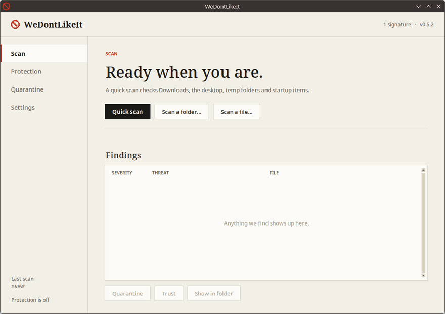
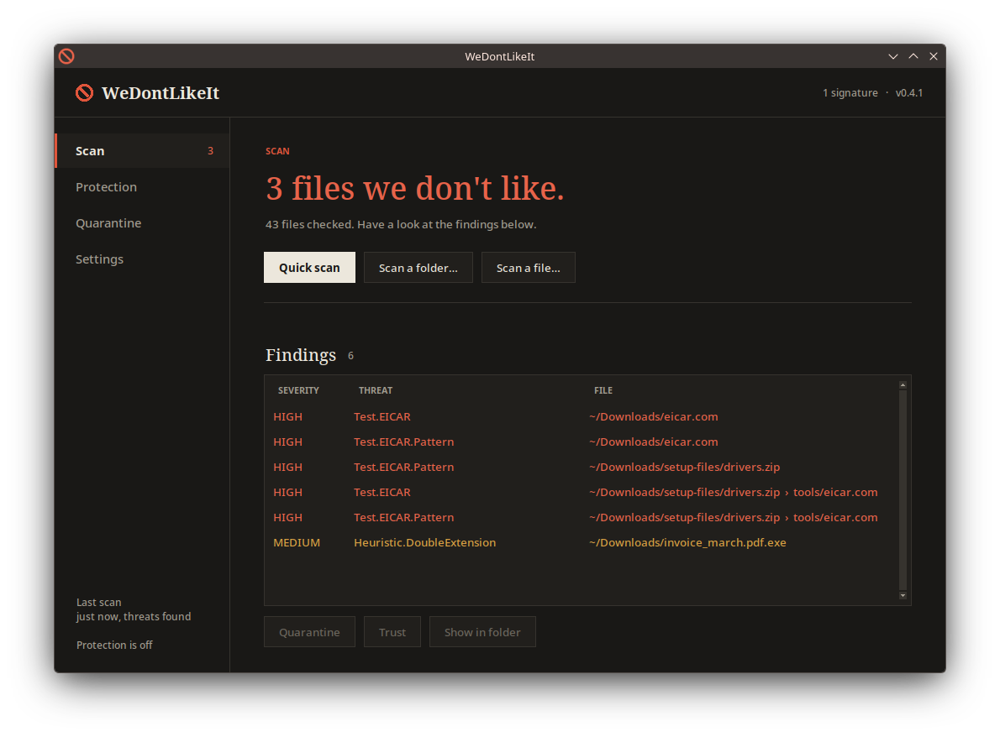
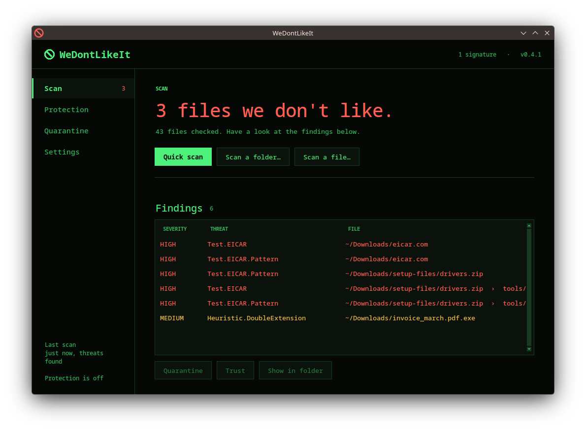
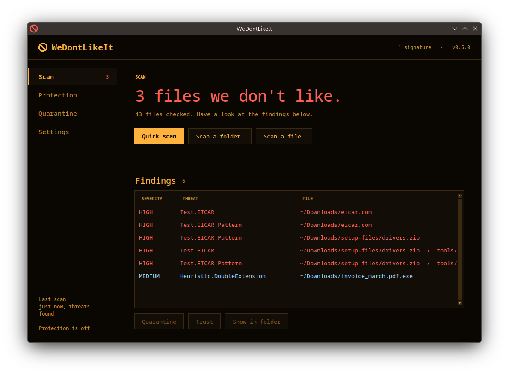
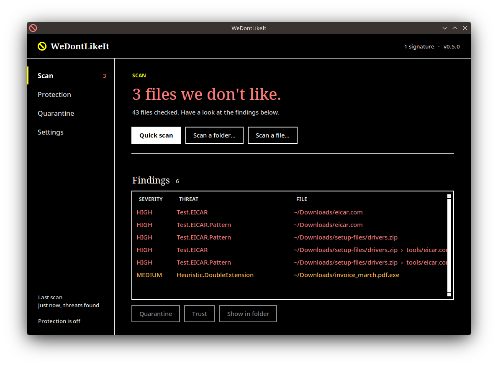
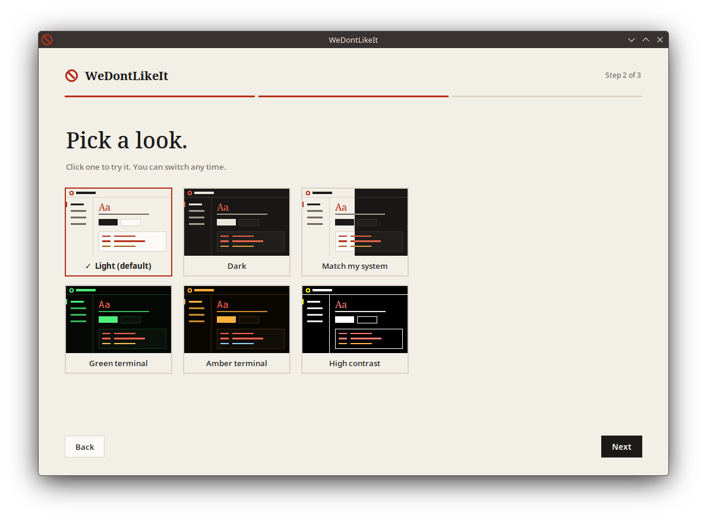

# WeDontLikeIt

A small antivirus for Linux, Windows and macOS, written in plain Python with no dependencies.
It runs entirely on your machine: no account, no cloud, no telemetry.

It comes as a desktop app and as a command-line tool. Both use the same engine.

It's open source under the MIT License. You're free to build on it, as long as you give credit
([details](#open-source-and-giving-credit)).



<table>
  <tr>
    <td></td>
    <td></td>
  </tr>
  <tr>
    <td align="center">Dark</td>
    <td align="center">Green terminal</td>
  </tr>
  <tr>
    <td></td>
    <td></td>
  </tr>
  <tr>
    <td align="center">Amber terminal</td>
    <td align="center">High contrast</td>
  </tr>
</table>

> This is a hobby project. It catches a fair amount, but it is not a replacement for
> Windows Defender, XProtect or ClamAV. Keep those on.

## Linux first

WeDontLikeIt is developed on Linux, and Linux is where it gets used and tested the most. New
features land there first, and Linux bugs get fixed first.

Windows and macOS are supported too, not an afterthought: the same code runs on all three, the test
suite runs on every one of them for every change, and each release ships builds for them. If something
works on Linux but breaks on Windows or macOS, that's a bug, so please
[open an issue](https://github.com/PRMEidiot/WeDontLikeIt/issues).

## Getting it

Grab a build for your system from [Releases](https://github.com/PRMEidiot/WeDontLikeIt/releases). You don't need Python installed.

- **Linux**: `WeDontLikeIt-linux` (app) or `wedontlikeit-cli-linux`
- **Windows**: `WeDontLikeIt-windows.exe` (app) or `wedontlikeit-cli-windows.exe`
- **macOS** (Apple Silicon): `WeDontLikeIt-macos-arm64.zip` (app) or `wedontlikeit-cli-macos-arm64`.
  On an Intel Mac, install from source (below).

The builds aren't signed, so your system will complain the first time:

- Linux: `chmod +x WeDontLikeIt-linux` first.
- Windows SmartScreen: *More info*, then *Run anyway*.
- macOS: right-click the app and choose *Open*, or run `xattr -dr com.apple.quarantine WeDontLikeIt.app`.

Windows Defender sometimes flags PyInstaller builds as suspicious. That's a known false positive
with PyInstaller, not something in this code, but if you'd rather not deal with it, install from source:

```bash
git clone https://github.com/PRMEidiot/WeDontLikeIt.git
cd WeDontLikeIt
pip install .          # or pip install ".[yara]" to use YARA rules
wedontlikeit-gui       # the app
wedontlikeit --help    # the command line
```

The app needs tkinter. It ships with Python on Windows and macOS. On Linux you may need
`sudo apt install python3-tk`, `sudo dnf install python3-tkinter` or `sudo pacman -S tk`.

## The app

The first time you open it, a short setup asks for your language (it starts in your system's
language), a theme and a few preferences.



After that, four pages, nothing hidden:

- **Scan**: a quick scan of the usual hiding places, or any folder or file you pick. Findings can be
  quarantined, trusted (if it's a false positive) or opened in your file manager.
- **Protection**: watches folders (Downloads and Desktop by default) and checks new files as soon as they land.
- **Quarantine**: everything that was locked away, with restore and delete.
- **Settings**: heuristics, archives, automatic quarantine, signature updates, language and theme.

Themes: Light, Dark, Match my system (follows your OS between light and dark, and switches to high
contrast when Windows' high contrast mode is on), Green terminal, Amber terminal, and High contrast
(pure black and white, thicker borders, slightly larger text). Every theme is checked against the
WCAG contrast guidelines in the tests.

## The command line

```
wedontlikeit quick                 # scan the usual hiding places
wedontlikeit scan ~/Downloads      # scan a folder
wedontlikeit scan -q D:\           # scan and quarantine high-severity threats
wedontlikeit watch                 # real-time protection for Downloads and Desktop
wedontlikeit update                # pull recent malware hashes from MalwareBazaar
wedontlikeit quarantine list
wedontlikeit quarantine restore <id>
wedontlikeit allow <file>          # trust a false positive
wedontlikeit info
```

Useful flags for `scan` and `quick`: `-q` quarantines high-severity hits, `--quarantine-all` also takes
medium ones, `--json` prints machine-readable output, `-j N` sets the number of worker processes,
`--yara rules/` adds YARA rules and `--exclude PATH` skips a path. Exit code is `0` when nothing was
found, `1` when something was, `2` on errors.


## Languages

English by default, plus Português (Brasil), Español, Français, Deutsch, Italiano, Nederlands,
Polski, Русский, Türkçe, 日本語, 한국어 and 简体中文. Pick one in Settings, with `--lang de`, or with
`WEDONTLIKEIT_LANG=de`.

English and Portuguese were written by hand. The rest were machine translated, so some phrasing
will be off. Fixes are very welcome: each language is a plain JSON file in
[`wedontlikeit/locales/`](https://github.com/PRMEidiot/WeDontLikeIt/tree/main/wedontlikeit/locales). Copy `en.json` to start a new one; the tests check
that every key, placeholder and plural form is there.

## What it looks for

**Known malware.** SHA-256 hashes and byte patterns. `update` downloads thousands of fresh hashes from
[MalwareBazaar](https://bazaar.abuse.ch/). Optional YARA rules on top.

**Suspicious executables.** For Windows PE files: packers (UPX, Themida, VMProtect, ASPack and others),
encrypted code sections, writable-and-executable sections, process injection and keylogging APIs,
and disk wipers: programs that write straight to the physical disk (where the boot sector lives) and
then force a blue screen or a shutdown, the way MEMZ and NotPetya do.
For Linux ELF and macOS Mach-O: UPX and packed or encrypted code.

**Scripts and one-liners.** Reverse shells, piping a download straight into a shell, PowerShell download
cradles and encoded commands, turning off Windows Defender, ransomware deleting backups (`vssadmin`,
`wbadmin`, `bcdedit`, `tmutil`), ransom notes, Windows tools abused to download payloads (`certutil`,
`mshta`, `regsvr32`, `bitsadmin`), PHP web shells, obfuscated `eval`, crypto miners, persistence
(Run keys, scheduled tasks, cron, LaunchAgents), fake macOS password prompts and browser data stealers.
These rules also read UTF-16 text, so they work on Windows scripts and `.lnk` shortcuts.

**Archives and documents.** It looks inside `.zip` and anything built on zip (`.docx`, `.xlsx`, `.jar`,
`.apk`...), up to three levels deep. It flags zip bombs, password-protected zips with an executable
inside (a phishing classic) and Office macros that run when the document opens.

**Tricky file names.** `photo.jpg.exe`, `invoice.pdf        .scr`, names that use the right-to-left
override character to hide `.exe`, and executables pretending to be documents.

Every finding has a severity:

- **High**: a known signature. It's malware.
- **Medium**: behaviour that's very hard to explain in a legitimate file.
- **Low**: worth knowing, often harmless (plenty of legit programs are packed with UPX).

Automatic quarantine only touches high by default.

False positives matter more than detection counts for a tool like this. As a sanity check, a scan of
about 120,000 files on a stock Linux system (`/usr/bin`, `/usr/share`, `/etc`) flags nothing.

## Where things are kept

| System  | Folder |
|---------|--------|
| Windows | `%LOCALAPPDATA%\WeDontLikeIt` |
| macOS   | `~/Library/Application Support/WeDontLikeIt` |
| Linux   | `~/.local/share/wedontlikeit` |

Inside you'll find `quarantine/` (files are XOR-scrambled and lose execute permission), `signatures/`
(downloaded hashes), `allowlist.hashes` and `config.json`. Set `WEDONTLIKEIT_HOME` to use another folder.

## Testing it

The [EICAR test file](https://www.eicar.org/download-anti-malware-testfile/) is a harmless file every
antivirus is supposed to flag. Download it and scan it.

## Your own signatures

Make a folder with `*.hashes` and/or `*.patterns` files and pass it with `--signatures`, or drop the
files into the `signatures/` folder above so they're always loaded.

```
# my.hashes:   <sha256> <Name>
e3b0c44298fc1c149afbf4c8996fb92427ae41e4649b934ca495991b7852b855 Example.Empty

# my.patterns: <Name> <bytes in hex, at least 4>
Example.Pattern 6d616c77617265
```

There are example YARA rules in [`rules/`](https://github.com/PRMEidiot/WeDontLikeIt/tree/main/rules). Put `severity = "medium"` (or `"low"`) in a rule's
meta to change its severity.

## Hacking on it

```bash
python -m unittest -v       # tests
python -m wedontlikeit gui  # run the app without installing
```

```
wedontlikeit/
  cli.py         command line
  gui.py         desktop app (tkinter)
  scanner.py     scan engine, runs in parallel
  signatures.py  hashes, patterns, allowlist
  heuristics.py  PE / ELF / Mach-O / Office / file name checks
  scripts.py     rules for malicious scripts and commands
  archives.py    looking inside zips, with zip-bomb limits
  quarantine.py  quarantine
  monitor.py     real-time protection (polling)
  updater.py     signature updates
  platforms.py   everything that differs between Windows, macOS and Linux
  i18n.py        translations, plural rules, number formatting
  locales/       one JSON file per language
  config.py      saved settings
```

GitHub Actions runs the tests on Windows, macOS and Linux on every push. Pushing a tag like `v0.5.2`
builds the apps and attaches them to a release.

One rule worth knowing: the test suite scans the project itself and fails if anything is flagged.
So if you write a detection rule, don't put a real-looking malicious command in a comment or a test
sample. The existing tests show how to break a sample up so it only becomes "real" at run time.

Ideas that would make it better: native file watching (inotify, FSEvents, ReadDirectoryChangesW)
instead of polling, `.rar`/`.7z`/`.tar.gz` support, importing ClamAV signatures.

## Open source, and giving credit

WeDontLikeIt is open source under the [MIT License](https://github.com/PRMEidiot/WeDontLikeIt/blob/main/LICENSE). You can use it, change it, ship it
inside your own project and even sell that project. You don't need to ask.

There is one condition, and it isn't optional: **if you use this code, or a substantial part of it,
as the base of your own project, you have to give credit.** In practice that means keeping the
copyright notice and the MIT license text from [`LICENSE`](https://github.com/PRMEidiot/WeDontLikeIt/blob/main/LICENSE) in your copy of the code.
If you ship a compiled program, include them alongside it too, for example in your docs or a
"licenses" screen. That's what the MIT License requires: without the notice, you don't have
permission to use the code.

Beyond that, a visible line in your README such as
"Based on [WeDontLikeIt](https://github.com/PRMEidiot/WeDontLikeIt)" isn't required, but it's
very much appreciated.

If you're only borrowing an idea (how the zip-bomb check works, say) and writing your own code,
you don't owe anything. A mention is still nice.
